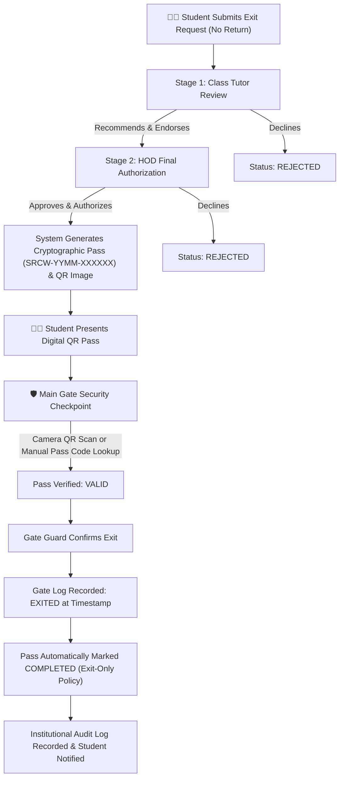

# 🛡️ SmartGate – College Gate Pass Management System
### Sri Ramakrishna College of Arts & Science for Women (SRCW)
**Sponsored by SNR Sons Trust · Coimbatore, Tamil Nadu**
*Autonomous Institution | Affiliated to Bharathiar University | Re-Accredited by NAAC*

---

## 🏛️ Executive Summary

**SmartGate** is a secure, institutional-grade digital Gate Pass Management System engineered specifically for **Sri Ramakrishna College of Arts & Science for Women (SRCW)** under **SNR Sons Trust**.

The system completely modernizes campus student departure logistics, enforcing strict academic governance, parental verification, and checkpoint security while operating **100% locally with zero paid third-party APIs, zero cloud subscriptions, and zero external vendor dependencies**.

---

## 📋 Key Institutional Policies & Architecture

### 1. Unidirectional Exit-Only Workflow (No Return)
The college instructional day concludes officially at **2:00 PM**. Consequently, all gate pass requests are for **early exit departure only**.
* Gate passes authorize a **single-use exit from campus**.
* Once the student's departure is scanned and confirmed by the Gate Guard at the main checkpoint, the pass is recorded in institutional logs and automatically marked as **`COMPLETED`**.
* There are **no return times**, **no return verification buttons**, and **no late return penalties**.

### 2. Strictly Five Institutional Roles (Faculty Removed)
The workflow removes redundant layers and establishes a clean 5-role governance model:
1. **Student** – Public self-registration into enrolled degree program; submits early departure requests with reason and exit time; presents official digital QR pass at checkpoint.
2. **Class Tutor** – Assigned to a specific annual class (`department_id + course_id + year`); verifies student attendance, contacts registered guardian for consent, and endorses genuine requests to the HOD.
3. **Head of Department (HOD)** – Departmental executive authority; performs final authorization, generating the cryptographic QR pass and alphanumeric pass code (`SRCW-YYMM-XXXXXX`).
4. **Gate Guard** – Security terminal stationed at the campus main gate; verifies passes using real-time browser camera scanning or manual pass code lookup, and confirms student exit.
5. **Administrator** – Institutional controller; provisions staff accounts, manages departments, courses, classes, tutor assignments, HOD appointments, direct password resets, and inspects complete security audit logs and CSV reports.

### 3. Exactly 5 Departments & 13 Degree Programs (No Sections)
The college operates with exactly one class per academic year for each course (`department_id + course_id + year`). **All section references have been eliminated**.

| Department | Dept Code | Degree Program | Course Code | Duration | Total Classes |
|---|:---:|---|:---:|:---:|:---:|
| **Commerce** | `COM` | M.Com CA | `MCOMCA` | 2 Years | 2 Classes |
| | | B.Com A&F | `BCOMAF` | 3 Years | 3 Classes |
| | | B.Com PA | `BCOMPA` | 3 Years | 3 Classes |
| | | B.Com CA | `BCOMCA` | 3 Years | 3 Classes |
| | | B.Com | `BCOM` | 3 Years | 3 Classes |
| **Computer Science** | `CS` | B.Sc Computer Science | `CS` | 3 Years | 3 Classes |
| | | Bachelor of Computer Applications | `BCA` | 3 Years | 3 Classes |
| | | B.Sc Information Technology | `IT` | 3 Years | 3 Classes |
| | | B.Sc Data Analytics | `DA` | 3 Years | 3 Classes |
| | | B.Sc Artificial Intelligence | `AI` | 3 Years | 3 Classes |
| **Business Administration** | `BBA` | Bachelor of Business Administration | `BBA` | 3 Years | 3 Classes |
| **Department of Biochemistry** | `BIOCHEM` | B.Sc Biochemistry | `BIOCHEM` | 3 Years | 3 Classes |
| **Department of Microbiology** | `MICROBIO` | B.Sc Microbiology | `MICROBIO` | 3 Years | 3 Classes |
| **Total** | **5 Depts** | **13 Programs** | | | **38 Classes** |

---

## 🔄 End-to-End Workflow Diagram



---

## 🛠️ Technology Stack (100% Free & Local)

* **Backend:** Python 3, Flask 3.0.0
* **Database:** SQLite 3 (relational local database with foreign key integrity and busy-timeout handling)
* **Branding & Visuals:** Dual institutional logos (`static/images/srcw_logo.png` & `static/images/snr_trust_logo.jpg`)
* **Security & Auth:** Werkzeug cryptography (`generate_password_hash`, `check_password_hash`), session management, role-based access control decorators (`@login_required(role)`)
* **Pass & QR Engine:** Python `qrcode` library with `Pillow` (saves high-resolution PNG and inlines base64 QR payload)
* **Live Camera Scanning:** HTML5 Canvas + `jsQR.js` (bundled offline, runs 100% client-side without internet)
* **Frontend Design:** Semantic HTML5, CSS3 with responsive custom CSS design system, FontAwesome icons, Jinja2 template inheritance
* **Reporting & Auditing:** Real-time CSV generation via Python `csv` module, comprehensive database audit trail (`audit_logs`)

---

## 🔑 Default Institutional Credentials

All seeded accounts are active and ready for immediate demonstration:

| Role | Username | Password | Full Name / Description | Jurisdiction |
|---|---|---|---|---|
| **Administrator** | `admin` | `admin123` | Institutional Administrator | Full Campus Governance |
| **Class Tutor** | `tutor_cs` | `tutor123` | Dr. Meena Krishnan | CS Dept (B.Sc CS Year 1, 2) |
| **Class Tutor** | `tutor_bca` | `tutor123` | Prof. Suresh Babu | CS Dept (BCA Year 1, 2, 3) |
| **Class Tutor** | `tutor_com` | `tutor123` | Dr. Radhika S. | Commerce (B.Com CA Year 1, 2, 3) |
| **Class Tutor** | `tutor_bba` | `tutor123` | Prof. Anitha R. | Business Administration |
| **Class Tutor** | `tutor_bio` | `tutor123` | Dr. Priya V. | Biochemistry Dept |
| **HOD** | `hod_cs` | `hod123` | Dr. Venkatesh R. | Head of Computer Science |
| **HOD** | `hod_commerce` | `hod123` | Dr. Saravanan K. | Head of Commerce |
| **HOD** | `hod_bba` | `hod123` | Dr. Malini Devi | Head of Business Administration |
| **HOD** | `hod_biochem` | `hod123` | Dr. Geetha Mohan | Head of Biochemistry |
| **HOD** | `hod_microbio` | `hod123` | Dr. Chitra Lakshmi | Head of Microbiology |
| **Gate Guard** | `guard001` | `guard123` | Ravi Security Officer | Main Campus Checkpoint (General) |
| **Gate Guard** | `guard002` | `guard123` | Kumar Security Guard | Main Campus Checkpoint (Morning) |
| **Student** | `priyacs` | `student123` | Priya S. (21BCS204) | B.Sc Computer Science - Year 3 |
| **Student** | `arunkumar` | `student123` | Arun Kumar R. (22BCA101) | BCA - Year 2 |
| **Student** | `kaviyacom` | `student123` | Kaviya M. (23BCC312) | B.Com CA - Year 1 |

> [!TIP]
> The unified login page (`/login`) includes interactive credential chips at the bottom. Clicking any chip automatically populates the username and password fields.

---

## 🚀 Running the Application

### 1. Prerequisites
Ensure Python 3.10+ is installed on your machine.

### 2. Virtual Environment Setup
Open PowerShell or Terminal in the project root:
```powershell
# Navigate to the workspace
cd c:\Users\kotha\OneDrive\Gatepass

# Activate virtual environment
venv\Scripts\activate
```

### 3. Verify Database Initialization & Seeding
```powershell
python database.py
```
*Expected output: `SRCW Database migration and seeding completed successfully.`*

### 4. Start the Application Server
```powershell
python app.py
```
Open your web browser and navigate to:
```
http://127.0.0.1:5000/
```

---

## 🧪 Running Automated End-to-End Tests

A comprehensive unit and integration test suite is included in `scratch/test_srcw_workflow.py`. It tests:
1. Public institutional pages and dual branding (`/`, `/about`, `/login`, `/register`).
2. Dynamic course and duration APIs (`/api/courses`, `/api/course/<id>/years`).
3. Unified authentication for all 5 roles.
4. Student self-registration and automatic class assignment (zero section fields).
5. Full unidirectional gatepass lifecycle: Request → Tutor → HOD → QR Pass → Guard Verification → Exit Confirmation → Status `COMPLETED` → Audit Log.
6. Administrative modules, user management, and CSV report export.

To run the complete test suite:
```powershell
python -u scratch/test_srcw_workflow.py
```
*Expected output:*
```
......
----------------------------------------------------------------------
Ran 6 tests in 3.709s

OK
```

---

## 📁 Project Directory Structure

```
c:\Users\kotha\OneDrive\Gatepass\
│
├── app.py                      # Core Flask application, controllers & APIs (2,000+ lines)
├── database.py                 # SQLite migration, schema definitions & institutional seeder
├── database.db                 # Production SQLite database file
├── requirements.txt            # Dependency specification (Flask, qrcode, Pillow, Werkzeug)
├── README.md                   # Complete institutional documentation & guide
│
├── static/
│   ├── css/
│   │   ├── style.css           # Institutional portal design system & dashboards
│   │   └── landing.css         # Public landing & about page styles
│   ├── js/
│   │   ├── app.js              # Notifications, modals, and dynamic UI logic
│   │   └── jsQR.js             # Offline-bundled client-side QR scanner library
│   ├── images/
│   │   ├── srcw_logo.png       # Sri Ramakrishna College of Arts & Science for Women Logo
│   │   └── snr_trust_logo.jpg  # SNR Sons Trust Logo
│   ├── qrcodes/                # Generated gate pass QR PNG assets
│   └── uploads/                # Student profile photos
│
├── templates/
│   ├── base.html               # Institutional base layout with dual logos & role navigation
│   ├── index.html              # Public landing page with institutional overview
│   ├── about.html              # College history, 5 depts, 13 courses, 5 roles, exit policy
│   ├── login.html              # Unified login card with quick credential chips
│   ├── register.html           # Public student self-registration (dynamic course dropdown)
│   │
│   ├── student/
│   │   ├── dashboard.html      # Active pass indicator & recent request timeline
│   │   ├── new_request.html    # Early departure request form (unidirectional, no return)
│   │   ├── my_requests.html    # Filterable request directory
│   │   ├── request_detail.html # Tutor & HOD decision tracking timeline
│   │   ├── pass_qr.html        # Official printable gate pass with large QR code
│   │   ├── approved_passes.html# Active authorized passes ready for security gate
│   │   ├── history.html        # Complete historical exit log
│   │   └── profile.html        # Academic records & contact phone editor
│   │
│   ├── tutor/
│   │   ├── dashboard.html      # Assigned classes overview & pending recommendation queue
│   │   ├── request_detail.html # Student profile, guardian phone verification, endorse/reject
│   │   ├── all_requests.html   # Filterable class passes
│   │   └── profile.html        # Official tutor credentials & assigned class jurisdiction
│   │
│   ├── hod/
│   │   ├── dashboard.html      # Department authorization queue & departure statistics
│   │   ├── request_detail.html # Review recommendation, authorize & activate digital QR pass
│   │   ├── all_requests.html   # Departmental gate pass directory
│   │   └── reports.html        # Date range & course filters with CSV export
│   │
│   ├── guard/
│   │   ├── dashboard.html      # Main gate security terminal, today's exit tally & quick lookup
│   │   ├── verify.html         # Live browser camera QR scanner & manual pass code verification
│   │   └── history.html        # Main gate departure log & search
│   │
│   └── admin/
│       ├── dashboard.html      # Institutional analytics & real-time system activity
│       ├── users.html          # User directory, role filter, direct password reset
│       ├── user_form.html      # Provision staff accounts (Tutor, HOD, Guard, Admin)
│       ├── user_edit.html      # Edit user accounts & reset credentials
│       ├── departments.html    # Manage 5 institutional departments
│       ├── courses.html        # Manage 13 degree programs & course durations
│       ├── classes.html        # 38 single-class year mappings (department_id + course_id + year)
│       ├── tutor_assignment.html # Assign Class Tutors to annual classes
│       ├── hod_assignment.html # Appoint HODs to academic departments
│       ├── audit_logs.html     # Cryptographic security audit log
│       └── reports.html        # Master institutional exit reports with CSV download
│
└── scratch/
    └── test_srcw_workflow.py   # Automated 6-part test suite verifying complete workflow
```

---

## 🎓 Academic Defense & Viva Q&A

### Q1: Why is there no return workflow or return status?
> **Answer:** At Sri Ramakrishna College for Arts and Science for Women, the college working day concludes at 2:00 PM. Gate passes are strictly issued for authorized early departure before 2:00 PM (medical consultations, emergencies, academic off-campus visits). Once a student departs through the main security gate, they do not re-enter for classes that day. The pass is automatically completed upon gate verification.

### Q2: Why is the Class model structured without Sections?
> **Answer:** Each degree course in the college maintains a single consolidated class cohort per academic year (`department_id + course_id + year`, e.g., B.Sc CS Year 1, B.Sc CS Year 2, B.Sc CS Year 3). To avoid artificial administrative fragmentation, section dropdowns and columns were eliminated in favor of a clean, deterministic class model.

### Q3: Why was the Faculty role removed?
> **Answer:** Having separate subject faculty approvals created unnecessary procedural bottlenecks. In an autonomous college structure, the designated **Class Tutor** already tracks attendance and acts as the student's primary academic counselor. The Class Tutor performs parental phone verification and endorses the request directly to the **Head of Department (HOD)** for final executive authorization.

### Q4: How is security ensured without external cloud authentication?
> **Answer:** All passwords are encrypted using PBKDF2 with SHA-256 hashes via the Werkzeug security library. All sensitive endpoints enforce server-side session role checks (`@login_required('admin')`, etc.). Every critical event (login, request creation, tutor endorsement, HOD authorization, gate exit, password reset) writes an immutable record to the `audit_logs` table with timestamp and IP address.

### Q5: How does the QR scanner function without an internet connection?
> **Answer:** The QR scanning engine uses `jsQR.js`, an open-source JavaScript computer vision library bundled locally in `static/js/jsQR.js`. It captures camera video frames using the HTML5 `getUserMedia` Web API and decodes the QR code on the browser client without sending any image data to external cloud services. For devices without a camera, the security terminal provides an instant manual pass code lookup fallback.

---

## 📜 Institutional Ownership & Credits
* **Institution:** Sri Ramakrishna College of Arts & Science for Women (SRCW)
* **Trust:** SNR Sons Trust, Coimbatore, Tamil Nadu
* **System:** SmartGate – College Gate Pass Management System
* **Status:** Complete, Functional, Fully Tested & Production-Ready
