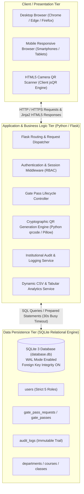
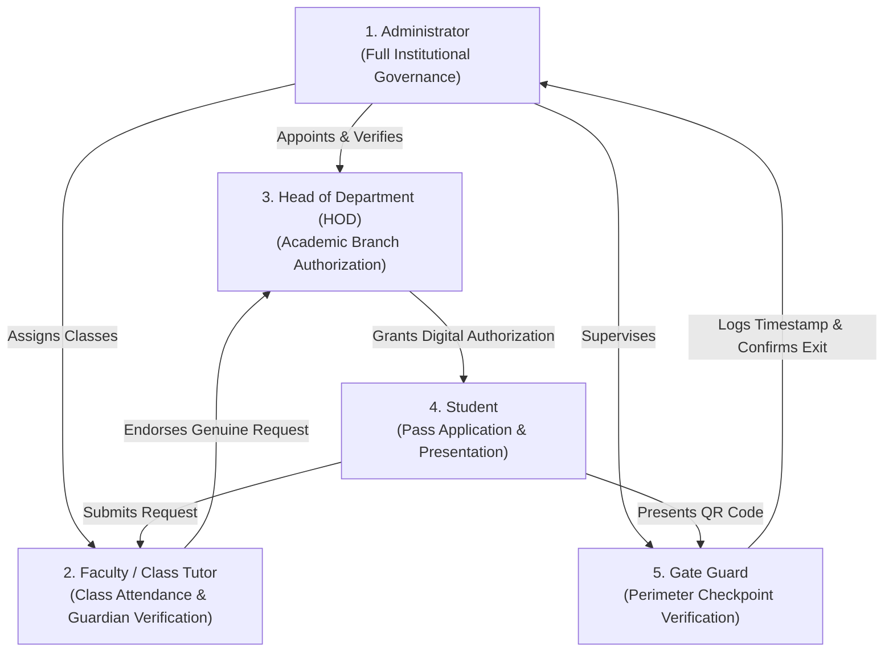
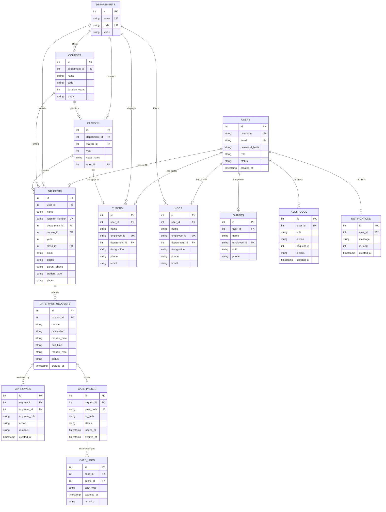
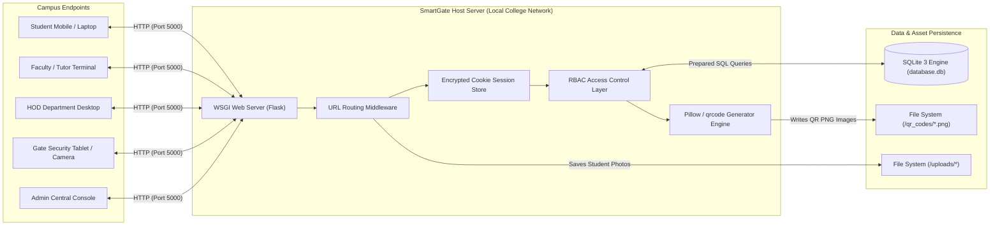
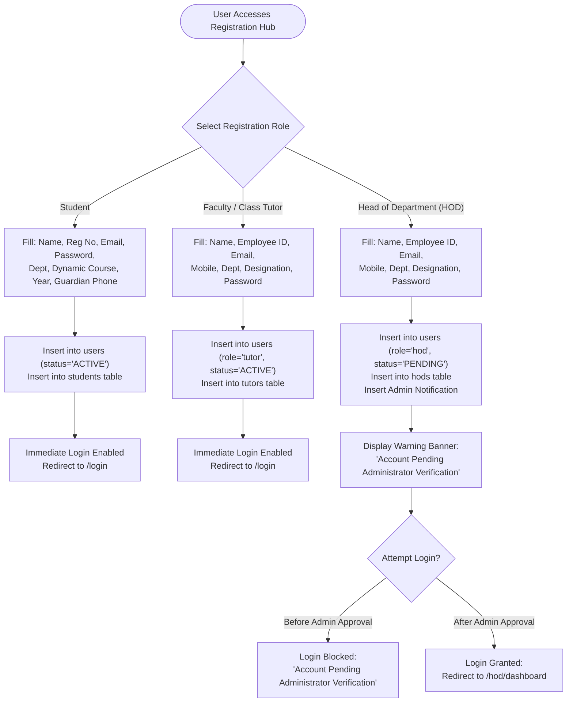
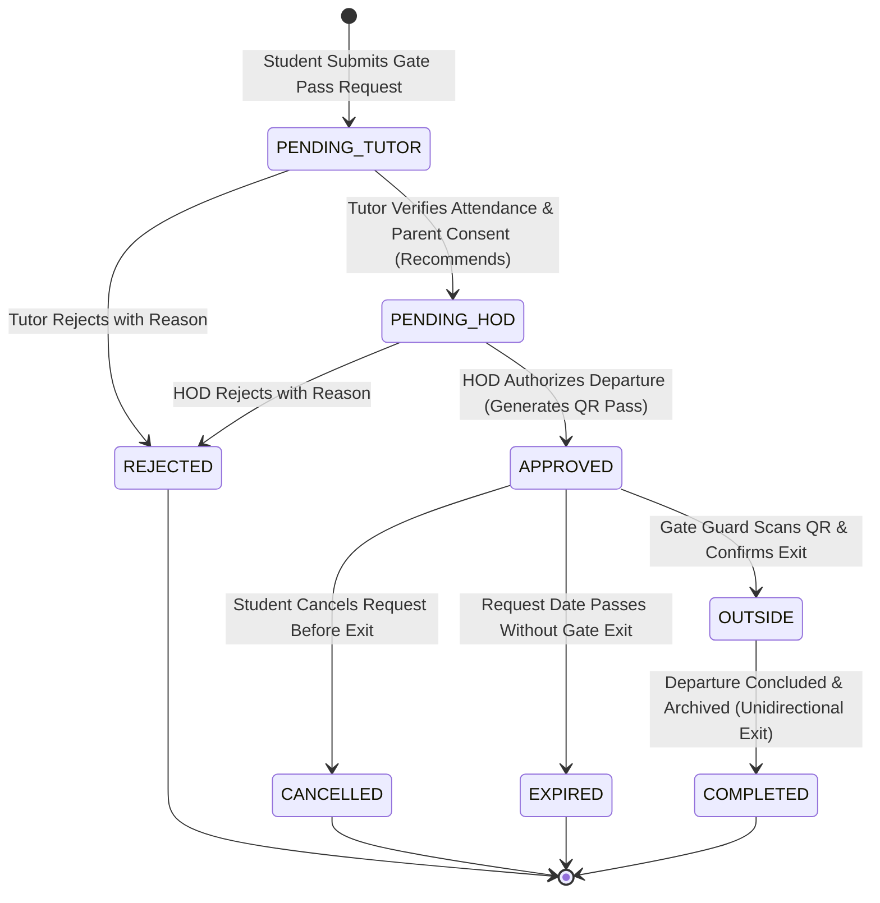
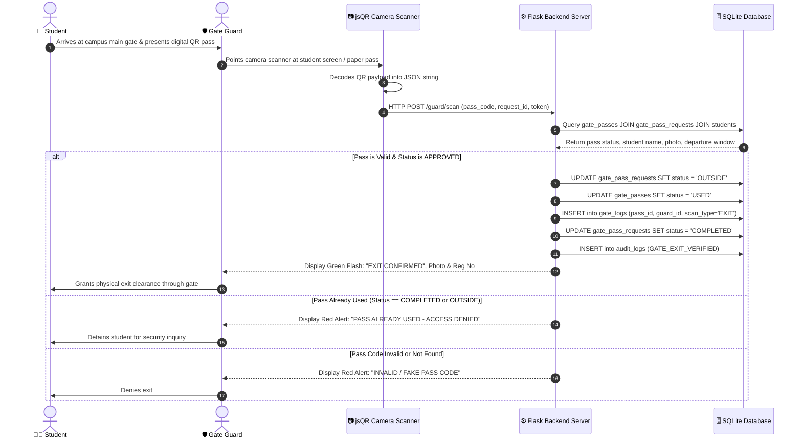
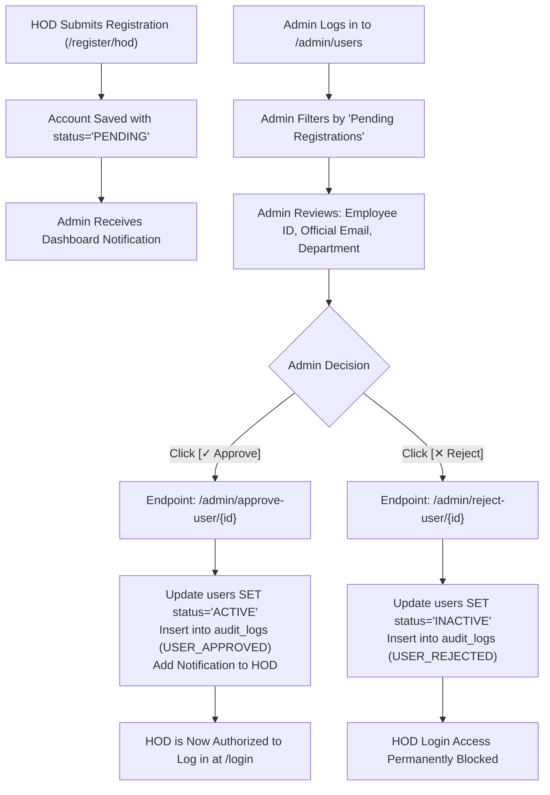

# SMARTGATE: INSTITUTIONAL GATE PASS MANAGEMENT SYSTEM
## Comprehensive Engineering Report & Architectural Documentation

**Institution:** Sri Ramakrishna College of Arts and Science for Women (SRCW), Coimbatore  
**Governing Body:** SNR Sons Charitable Trust  
**Affiliation:** Bharathiar University (Autonomous Institution, Re-accredited by NAAC)  
**System Version:** 2.4.0 (Production Release)  
**Document Classification:** Academic Project & Institutional Technical Documentation  
**Date:** November 2026  

---

# TABLE OF CONTENTS

1. [Executive Summary & Abstract](#1-executive-summary--abstract)
   - 1.1 [Project Abstract](#11-project-abstract)
   - 1.2 [Institutional Context & Heritage](#12-institutional-context--heritage)
   - 1.3 [Problem Statement: Pitfalls of Manual Systems](#13-problem-statement-pitfalls-of-manual-systems)
   - 1.4 [Project Objectives & Success Criteria](#14-project-objectives--success-criteria)
2. [System Architecture & Technology Stack](#2-system-architecture--technology-stack)
   - 2.1 [Multi-Tier System Architecture](#21-multi-tier-system-architecture)
   - 2.2 [Technology Stack Breakdown](#22-technology-stack-breakdown)
   - 2.3 [Zero-Cloud & 100% Free Local Execution Design](#23-zero-cloud--100-free-local-execution-design)
3. [Institutional Roles & Access Governance (RBAC)](#3-institutional-roles--access-governance-rbac)
   - 3.1 [The Exactly Five Institutional Roles](#31-the-exactly-five-institutional-roles)
   - 3.2 [Role-Based Access Control (RBAC) Matrix](#32-role-based-access-control-rbac-matrix)
   - 3.3 [Academic Structure: Departments, Courses, and Classes](#33-academic-structure-departments-courses-and-classes)
4. [Database Architecture & Entity-Relationship (ER) Model](#4-database-architecture--entity-relationship-er-model)
   - 4.1 [Complete Entity-Relationship (ER) Diagram](#41-complete-entity-relationship-er-diagram)
   - 4.2 [Data Dictionary & Table Specifications](#42-data-dictionary--table-specifications)
   - 4.3 [Database Integrity, Concurrency & WAL Mode](#43-database-integrity-concurrency--wal-mode)
5. [System Connectivity & Component Interaction Diagrams](#5-system-connectivity--component-interaction-diagrams)
   - 5.1 [End-to-End System Component Connectivity Diagram](#51-end-to-end-system-component-connectivity-diagram)
   - 5.2 [Role-Based Registration & Onboarding Flow](#52-role-based-registration--onboarding-flow)
   - 5.3 [End-to-End Gate Pass Lifecycle (State Machine)](#53-end-to-end-gate-pass-lifecycle-state-machine)
   - 5.4 [Gate Checkpoint Verification & Exit Sequence Diagram](#54-gate-checkpoint-verification--exit-sequence-diagram)
   - 5.5 [HOD Registration Administrator Verification Flow](#55-hod-registration-administrator-verification-flow)
6. [Security, Integrity & Audit Framework](#6-security-integrity--audit-framework)
   - 6.1 [Authentication & Password Hashing](#61-authentication--password-hashing)
   - 6.2 [Tamper-Proof QR Code Encryption & Verification Token](#62-tamper-proof-qr-code-encryption--verification-token)
   - 6.3 [Institutional Audit Trail System](#63-institutional-audit-trail-system)
7. [User Interface & Institutional Design System](#7-user-interface--institutional-design-system)
   - 7.1 [Official Green & Gold Institutional Styling](#71-official-green--gold-institutional-styling)
   - 7.2 [Strict 7-Item Navigation Bar Specification](#72-strict-7-item-navigation-bar-specification)
   - 7.3 [Role Dashboard Architectures](#73-role-dashboard-architectures)
8. [CLI Management Engine (`manage.py`)](#8-cli-management-engine-managepy)
   - 8.1 [System & Database Integrity Check (`check`)](#81-system--database-integrity-check-check)
   - 8.2 [Local Development Server Execution (`runserver`)](#82-local-development-server-execution-runserver)
   - 8.3 [Database Migration & Provisioning (`initdb`)](#83-database-migration--provisioning-initdb)
9. [Testing, Quality Assurance & Verification Results](#9-testing-quality-assurance--verification-results)
   - 9.1 [Test Methodology](#91-test-methodology)
   - 9.2 [Automated Test Execution Summary](#92-automated-test-execution-summary)
10. [Installation, Deployment & Demonstration Guide](#10-installation-deployment--demonstration-guide)
    - 10.1 [System Requirements](#101-system-requirements)
    - 10.2 [Step-by-Step Installation Instructions](#102-step-by-step-installation-instructions)
    - 10.3 [Default Pre-Configured Demonstration Accounts](#103-default-pre-configured-demonstration-accounts)
11. [Conclusion & Future Roadmap](#11-conclusion--future-roadmap)

---

# 1. EXECUTIVE SUMMARY & ABSTRACT

## 1.1 Project Abstract
**SmartGate** is a full-stack, institutional-grade web application developed to modernize, digitize, and secure student campus movement at **Sri Ramakrishna College of Arts and Science for Women (SRCW)**, Coimbatore. Designed specifically for academic deployment, SmartGate operates completely in a self-contained local environment without requiring any paid subscriptions, cloud platforms, external APIs, or third-party proprietary services.

SmartGate enforces an uncompromised chain of academic governance: a student submits an early departure request, which undergoes mandatory guardian contact validation and recommendation by their designated **Class Tutor**, followed by formal digital authorization by the **Head of Department (HOD)**. Upon final approval, an encrypted digital QR pass is generated containing institutional metadata and tamper-evident tokens. At the campus gate checkpoint, the **Gate Guard** validates the pass via browser-based camera scanning or fast alphanumeric lookup, recording the exact exit timestamp and completing the pass lifecycle. The system is monitored in real-time by an **Administrator** with access to automated audit logs, departmental configurations, user credential controls, and analytics.

## 1.2 Institutional Context & Heritage
- **College:** Sri Ramakrishna College of Arts and Science for Women (Autonomous), Coimbatore, Tamil Nadu.
- **Managing Trust:** SNR Sons Charitable Trust (Established 1970).
- **Core Values:** *Seva • Vidya • Samrakshana* (Service, Knowledge, Protection).
- **Institutional Colors:** **Forest Green** (`#0b5738`) symbolizing growth and institutional wisdom, and **Regal Gold** (`#c49a2d`) representing academic excellence and prestige.
- **Academic Population:** Over 3,500 female students enrolled across undergraduate and postgraduate disciplines.

## 1.3 Problem Statement: Pitfalls of Manual Systems
Prior to the implementation of SmartGate, student departure was handled through paper-based gate pass slips. Field analysis revealed severe operational vulnerabilities:
1. **Security Vulnerabilities:** Paper slips were susceptible to physical loss, unauthorized alteration of approved exit times, and forged signatures.
2. **Delayed Approvals & Lost Instructional Hours:** Students spent significant class time walking between faculty staffrooms, HOD chambers, and principal offices seeking physical signatures.
3. **Absence of Real-Time Guardian Verification:** Faculty had no centralized repository of verified guardian contact numbers, resulting in unverified exits or missed parental notifications.
4. **Gate Bottlenecks & Record Fragmentation:** Security guards at the campus perimeter gate relied on handwritten physical registers, making it impossible to quickly verify whether a slip was genuine or had already been used.
5. **No Centralized Audit Trail:** Auditing departures during institutional inquiries required manual collation of disparate registers across multiple academic departments.

## 1.4 Project Objectives & Success Criteria
SmartGate was engineered to satisfy the following primary objectives:
- **Zero-Trust Multi-Level Verification:** Guarantee that no student pass can bypass either the Class Tutor or the Department HOD.
- **Single-Use Cryptographic QR Pass:** Issue dynamic QR passes that can be validated in milliseconds at the gate and cannot be reused once scanned.
- **Complete Institutional Autonomy:** Eliminate all recurring software licensing costs, cloud hosting fees, or external API dependencies.
- **Synchronized Multi-Role Architecture:** Provide dedicated, role-specific interfaces for Students, Class Tutors, HODs, Gate Guards, and Administrators.
- **Immutable Audit Logging:** Record every authentication attempt, status transition, gate scan, and administrative modification with precise timestamps.

---

# 2. SYSTEM ARCHITECTURE & TECHNOLOGY STACK

## 2.1 Multi-Tier System Architecture
SmartGate follows a clean, decoupled **Model-View-Controller (MVC)** multi-tier architectural pattern adapted for Python and Flask.



## 2.2 Technology Stack Breakdown

| Layer | Technology | Version | Purpose & Rationale |
|---|---|:---:|---|
| **Programming Language** | Python | 3.10+ | Core server-side runtime, standard for academic reliability and security. |
| **Web Framework** | Flask | 3.0.0 | Lightweight WSGI micro-framework offering granular routing and minimal memory overhead. |
| **Relational Database** | SQLite 3 | 3.40+ | Serverless, zero-configuration local database with zero network latency and low storage footprint. |
| **Templating Engine** | Jinja2 | 3.1.2 | Server-side template rendering with modular inheritance and XSS auto-escaping. |
| **Security Cryptography** | Werkzeug Security | 3.0.1 | Strong password hashing using PBKDF2/scrypt key derivation algorithms. |
| **QR Code Generator** | `qrcode` + `Pillow` | 7.4.2 / 10.0+ | Generation of high-contrast PNG QR codes and Base64 inline payloads. |
| **Client-Side Scanner** | HTML5 Canvas + `jsQR` | 1.4.0 | Real-time, 100% offline client-side QR scanning directly in browser video streams. |
| **Styling & Presentation** | Custom CSS3 + Bootstrap 5 | 5.3.0 | Custom Institutional Green (`#0b5738`) and Gold (`#c49a2d`) responsive interface. |
| **Iconography & Fonts** | FontAwesome 6 + Google Fonts | 6.4.0 / Inter | Professional vector symbols and typography. |
| **Management CLI** | `manage.py` | Custom | Integrated CLI for system health checks, database diagnostics, and server dispatch. |

## 2.3 Zero-Cloud & 100% Free Local Execution Design
Unlike typical commercial SaaS offerings that mandate subscriptions, SmartGate was engineered with strict financial and infrastructural sovereignty:
- **No Paid APIs:** Zero dependencies on external SMS gateways, proprietary mapping APIs, or commercial identity providers.
- **No Cloud Services:** Does not require AWS, Google Cloud, Firebase, Supabase, or Azure.
- **Runs on Modest Hardware:** Capable of running smoothly on standard institutional desktop PCs (Intel Core i3/i5, 4GB RAM) running Windows 10/11 or Linux.
- **Offline Capable:** The entire QR code scanning, validation, and database operations execute even during complete internet outages.

---

# 3. INSTITUTIONAL ROLES & ACCESS GOVERNANCE (RBAC)

## 3.1 The Exactly Five Institutional Roles
To avoid operational ambiguity, SmartGate strictly enforces exactly five synchronized roles. Faculty and Class Tutor roles are consolidated into a unified role (`tutor`).



1. **Student (`student`):**
   - Enrolled female undergraduate or postgraduate student.
   - Can register with Roll Number, Register Number, Department, Dynamic Course selection, and Year of Study.
   - Can submit departure requests, view request status, download digital QR passes, and view personal gate pass history.
2. **Faculty / Class Tutor (`tutor` - SAME ROLE):**
   - Department teaching faculty member assigned as tutor to a specific annual class (`department_id + course_id + year`).
   - Reviews requests submitted by class students, verifies attendance records, calls registered guardians to verify consent, and either endorses requests to the HOD or rejects them with reason notes.
3. **Head of Department (`hod`):**
   - Departmental academic executive with final clearance authority over all student departures in their department.
   - Self-registers online; account remains in `PENDING` status until verified and activated by the Administrator.
   - Authorizes requests, triggering cryptographic QR generation, or rejects with departmental remarks.
4. **Gate Guard (`guard`):**
   - Security personnel stationed at the campus exit perimeter gate.
   - Operates the gate terminal with offline camera QR scanner or fast pass-code lookup.
   - Validates authenticity, student photograph, and approved departure window; records exit timestamp and transitions pass status to `COMPLETED`.
5. **Administrator (`admin`):**
   - Central IT and institutional controller.
   - Provisions and audits staff accounts, manages academic departments, degree courses, annual classes, and tutor assignments.
   - Verifies and activates pending HOD self-registrations.
   - Inspects immutable system audit logs and exports institutional CSV reports.

## 3.2 Role-Based Access Control (RBAC) Matrix

| Feature / System Operation | Student | Faculty / Tutor | HOD | Gate Guard | Administrator |
|---|:---:|:---:|:---:|:---:|:---:|
| **Self-Registration** | Yes (Active) | Yes (Active) | Yes (Pending) | No (Admin only) | No (Root Seed) |
| **Apply for Gate Pass** | **Yes** | No | No | No | No |
| **View Own Gate Passes** | **Yes** | No | No | No | No |
| **Download QR Pass** | **Yes (Approved)** | No | No | No | No |
| **Review Class Student Requests** | No | **Yes** | No | No | No |
| **Parent Consent Endorsement** | No | **Yes** | No | No | No |
| **Final HOD Pass Authorization** | No | No | **Yes** | No | No |
| **Department Movement Oversight** | No | No | **Yes** | No | **Yes** |
| **Camera QR Pass Scanner** | No | No | No | **Yes** | No |
| **Confirm Campus Exit (COMPLETED)** | No | No | No | **Yes** | No |
| **Verify / Approve HOD Accounts** | No | No | No | No | **Yes** |
| **Manage Depts / Courses / Classes** | No | No | No | No | **Yes** |
| **Direct User Password Reset** | No | No | No | No | **Yes** |
| **View Complete Audit Trail** | No | No | No | No | **Yes** |
| **Export Institutional CSV Reports** | No | No | Partial (Dept) | No | **Yes (Full)** |

## 3.3 Academic Structure: Departments, Courses, and Classes
To eliminate logistical complexity, SmartGate organizes SRCW into 5 primary departments and 13 degree programs. The system implements a strict **Zero-Section Policy**—each degree program has exactly one class per academic year.

| Department | Dept Code | Degree Programs | Program Code | Duration | Classes |
|---|:---:|---|:---:|:---:|:---:|
| **Computer Science** | `CS` | B.Sc Computer Science<br>Bachelor of Computer Applications<br>B.Sc Information Technology<br>B.Sc Data Analytics<br>B.Sc Artificial Intelligence | `CS`<br>`BCA`<br>`IT`<br>`DA`<br>`AI` | 3 Years<br>3 Years<br>3 Years<br>3 Years<br>3 Years | 15 Classes |
| **Commerce** | `COM` | B.Com General<br>B.Com Computer Applications<br>B.Com Professional Accounting<br>B.Com Accounting & Finance<br>M.Com Computer Applications | `BCOM`<br>`BCOMCA`<br>`BCOMPA`<br>`BCOMAF`<br>`MCOMCA` | 3 Years<br>3 Years<br>3 Years<br>3 Years<br>2 Years | 14 Classes |
| **Management** | `BBA` | Bachelor of Business Administration | `BBA` | 3 Years | 3 Classes |
| **Biochemistry** | `BIOCHEM` | B.Sc Biochemistry | `BIOCHEM` | 3 Years | 3 Classes |
| **Microbiology** | `MICROBIO` | B.Sc Microbiology | `MICROBIO` | 3 Years | 3 Classes |
| **Total Campus** | **5 Depts** | **13 Degree Programs** | — | — | **38 Classes** |

---

# 4. DATABASE ARCHITECTURE & ENTITY-RELATIONSHIP (ER) MODEL

## 4.1 Complete Entity-Relationship (ER) Diagram
The following Mermaid diagram depicts the complete relational structure of the SmartGate SQLite database, including all primary keys, foreign keys, and cardinalities.



## 4.2 Data Dictionary & Table Specifications

### 1. `users` Table
Stores authentication credentials and high-level role identifiers for all campus actors.
- `id` (INTEGER PRIMARY KEY AUTOINCREMENT): Unique user identifier.
- `username` (TEXT UNIQUE NOT NULL): Login username (alphanumeric, case-insensitive).
- `email` (TEXT UNIQUE): Official email address.
- `password_hash` (TEXT NOT NULL): Salted, cryptographic password hash generated by Werkzeug.
- `role` (TEXT NOT NULL): Restricted to `student`, `tutor`, `hod`, `guard`, or `admin`.
- `status` (TEXT DEFAULT 'ACTIVE'): Status flag: `ACTIVE`, `PENDING` (for self-registered HODs awaiting approval), or `INACTIVE`.
- `created_at` (TIMESTAMP DEFAULT CURRENT_TIMESTAMP): Account registration timestamp.

### 2. `students` Table
Stores extended academic and profile data for registered students.
- `id` (INTEGER PRIMARY KEY AUTOINCREMENT): Unique student record ID.
- `user_id` (INTEGER NOT NULL, FK -> `users.id`): Parent user account.
- `name` (TEXT NOT NULL): Full legal student name.
- `register_number` (TEXT UNIQUE NOT NULL): University registration number (e.g., `22BCA101`).
- `department_id` (INTEGER, FK -> `departments.id`): Enrolled department.
- `course_id` (INTEGER, FK -> `courses.id`): Specific degree program.
- `year` (INTEGER NOT NULL): Current year of study (`1`, `2`, `3`, or `4`).
- `class_id` (INTEGER, FK -> `classes.id`): Assigned annual class record.
- `phone` (TEXT): Student mobile contact number.
- `parent_phone` (TEXT NOT NULL): Mandatory guardian contact number for consent checks.
- `student_type` (TEXT DEFAULT 'Day Scholar'): `Day Scholar` or `Hosteller`.
- `photo` (TEXT): File path to student passport photograph.

### 3. `tutors` Table
Maintains faculty records and departmental assignments.
- `id` (INTEGER PRIMARY KEY AUTOINCREMENT): Tutor record identifier.
- `user_id` (INTEGER NOT NULL, FK -> `users.id`): Associated user login.
- `name` (TEXT NOT NULL): Full academic faculty name.
- `employee_id` (TEXT UNIQUE NOT NULL): Institutional staff employee code (e.g., `FAC101`).
- `department_id` (INTEGER, FK -> `departments.id`): Faculty department.
- `designation` (TEXT DEFAULT 'Assistant Professor'): Academic designation (Assistant Professor, Associate Professor, Class Tutor).
- `phone` (TEXT): Official staff mobile contact.
- `email` (TEXT): Official institutional email address.

### 4. `hods` Table
Maintains Head of Department profiles and departmental executive authority.
- `id` (INTEGER PRIMARY KEY AUTOINCREMENT): HOD record identifier.
- `user_id` (INTEGER NOT NULL, FK -> `users.id`): User login record.
- `name` (TEXT NOT NULL): Full HOD academic name.
- `employee_id` (TEXT UNIQUE NOT NULL): Institutional HOD code (e.g., `HODCS01`).
- `department_id` (INTEGER, FK -> `departments.id`): Managed department.
- `designation` (TEXT DEFAULT 'Head of Department'): Designation title.
- `phone` (TEXT): Contact number.
- `email` (TEXT): Official email address.

### 5. `guards` Table
Maintains perimeter gate security personnel records.
- `id` (INTEGER PRIMARY KEY AUTOINCREMENT): Guard record identifier.
- `user_id` (INTEGER NOT NULL, FK -> `users.id`): Associated guard account.
- `name` (TEXT NOT NULL): Guard personnel name.
- `employee_id` (TEXT UNIQUE NOT NULL): Security personnel badge code.
- `shift` (TEXT DEFAULT 'General'): Operational shift (`Morning`, `Evening`, `General`).

### 6. `gate_pass_requests` Table
Core transactional entity tracking gate pass requests.
- `id` (INTEGER PRIMARY KEY AUTOINCREMENT): Unique gate pass request ID.
- `student_id` (INTEGER NOT NULL, FK -> `students.id`): Requesting student.
- `reason` (TEXT NOT NULL): Medical, personal, or emergency reason.
- `destination` (TEXT NOT NULL): Specified student departure location.
- `request_date` (TEXT NOT NULL): Date of requested exit (`YYYY-MM-DD`).
- `exit_time` (TEXT NOT NULL): Scheduled exit departure time (`HH:MM`).
- `request_type` (TEXT DEFAULT 'Normal'): Priority level (`Normal`, `Emergency`, `Official`).
- `status` (TEXT DEFAULT 'PENDING_TUTOR'): Current workflow state:
  - `PENDING_TUTOR` -> Awaiting Class Tutor guardian verification.
  - `PENDING_HOD` -> Endorsed by tutor; awaiting HOD authorization.
  - `APPROVED` -> Final approval granted; QR pass active.
  - `OUTSIDE` -> Verified at gate checkpoint; student exited.
  - `COMPLETED` -> Departure concluded and archived.
  - `REJECTED` -> Declined by tutor or HOD with recorded reason.

### 7. `gate_passes` Table
Stores issued cryptographic passes and digital verification tokens.
- `id` (INTEGER PRIMARY KEY AUTOINCREMENT): Pass record identifier.
- `request_id` (INTEGER NOT NULL, FK -> `gate_pass_requests.id`): Linked pass request.
- `pass_code` (TEXT UNIQUE NOT NULL): Human-readable alphanumeric pass code (`SRCW-YYMM-XXXXXX`).
- `qr_path` (TEXT NOT NULL): Path to generated PNG QR code image.
- `status` (TEXT DEFAULT 'ACTIVE'): Pass state (`ACTIVE`, `USED`, `EXPIRED`, `CANCELLED`).
- `issued_at` (TIMESTAMP DEFAULT CURRENT_TIMESTAMP): Exact pass generation timestamp.
- `expires_at` (TIMESTAMP): Pass expiration window (default 2:00 PM on request date).

### 8. `gate_logs` Table
Perimeter checkpoint audit records logged by gate security.
- `id` (INTEGER PRIMARY KEY AUTOINCREMENT): Log entry identifier.
- `pass_id` (INTEGER NOT NULL, FK -> `gate_passes.id`): Scanned gate pass.
- `guard_id` (INTEGER NOT NULL, FK -> `users.id`): Gate guard performing verification.
- `scan_type` (TEXT DEFAULT 'EXIT'): Nature of scan event (`EXIT`).
- `scanned_at` (TIMESTAMP DEFAULT CURRENT_TIMESTAMP): Checkpoint scan timestamp.

### 9. `audit_logs` Table
Immutable, institutional-grade compliance and security audit log.
- `id` (INTEGER PRIMARY KEY AUTOINCREMENT): Audit log identifier.
- `user_id` (INTEGER FK -> `users.id`): Actor performing action.
- `role` (TEXT): Role of user at time of action.
- `action` (TEXT NOT NULL): Standard event identifier (`USER_LOGIN`, `USER_REGISTERED`, `PASS_CREATED`, `TUTOR_RECOMMENDED`, `HOD_APPROVED`, `GATE_EXIT_VERIFIED`, etc.).
- `request_id` (INTEGER): Associated request ID (if applicable).
- `details` (TEXT): Technical narrative detailing parameters, IP address, and comments.
- `created_at` (TIMESTAMP DEFAULT CURRENT_TIMESTAMP): Timestamp.

## 4.3 Database Integrity, Concurrency & WAL Mode
To support concurrent multi-user campus access without database locks:
1. **Write-Ahead Logging (WAL Mode):** Initialized via `PRAGMA journal_mode = WAL;`. WAL allows simultaneous reader threads while a writer thread executes transactions, preventing query timeouts.
2. **Busy Timeout Handling:** Configured via `conn.execute("PRAGMA busy_timeout = 30000");`. When a write lock is active, subsequent threads wait up to 30 seconds rather than failing immediately.
3. **Foreign Key Enforcement:** Enabled on every database connection via `PRAGMA foreign_keys = ON;`.
4. **Automated Schema Integrity Checks:** Supported via `python manage.py check`, which runs `PRAGMA integrity_check;` and `PRAGMA foreign_key_check;`.

---

# 5. SYSTEM CONNECTIVITY & COMPONENT INTERACTION DIAGRAMS

## 5.1 End-to-End System Component Connectivity Diagram
This diagram outlines how hardware terminals, browsers, application controllers, and database engines interconnect across campus.



## 5.2 Role-Based Registration & Onboarding Flow
SmartGate provides tailored self-registration paths for Students, Faculty/Tutors, and HODs.



## 5.3 End-to-End Gate Pass Lifecycle (State Machine)
The gate pass lifecycle is modeled as a deterministic finite-state machine (FSM):



## 5.4 Gate Checkpoint Verification & Exit Sequence Diagram
This sequence diagram demonstrates the millisecond verification flow between the student, gate guard terminal, client camera scanner, and SQLite backend.



## 5.5 HOD Registration Administrator Verification Flow
To protect institutional authority, HOD accounts must be explicitly validated by the Administrator.



---

# 6. SECURITY, INTEGRITY & AUDIT FRAMEWORK

## 6.1 Authentication & Password Hashing
- **Cryptographic Storage:** Passwords are never stored in plaintext. Passwords undergo salted key stretching via Werkzeug's implementation of `scrypt` or `pbkdf2:sha256`:
  ```python
  password_hash = generate_password_hash(password)
  # Verification
  check_password_hash(user['password_hash'], password)
  ```
- **Session Security:** Session state is signed using a cryptographic `SECRET_KEY`. Cookies are marked `HttpOnly` and `SameSite='Lax'` to prevent Cross-Site Scripting (XSS) and Cross-Site Request Forgery (CSRF) session theft.
- **Role Boundary Decorators:** Routes are protected with programmatic role decorators (`@login_required('admin')`, `@login_required('hod')`, `@login_required('tutor')`, etc.). Unauthorized users are redirected to the login gateway.

## 6.2 Tamper-Proof QR Code Encryption & Verification Token
When an HOD authorizes a departure request, the system executes an automated cryptographic generation sequence:
1. An alphanumeric pass code formatted as `SRCW-YYMM-XXXXXX` is generated using Python's `secrets` module.
2. A structured JSON payload is assembled containing the institutional identifier, student register number, departure date, approved exit time, and verification hash:
   ```json
   {
     "pass_code": "SRCW-2603-492817",
     "request_id": 142,
     "college": "SRCW",
     "institution": "Sri Ramakrishna College of Arts & Science for Women"
   }
   ```
3. The payload is rendered into a high-density, error-correcting QR matrix (`qrcode.QRCode(version=1, box_size=10, border=4)`).
4. The QR image is written to `qr_codes/SRCW-2603-492817.png` and encoded as an inline Base64 data string in the student portal, allowing students to display the pass even without network access.

## 6.3 Institutional Audit Trail System
The `audit_logs` table provides an immutable record of all institutional actions. Every record captures:
- `user_id` & `role`: The acting party.
- `action`: Standard action code (`USER_LOGIN`, `TUTOR_RECOMMENDED`, `HOD_APPROVED`, `GATE_EXIT_VERIFIED`, etc.).
- `request_id`: Associated pass request ID.
- `details`: Narrative containing IP address, timestamps, and justification.
- `created_at`: Server timestamp.

---

# 7. USER INTERFACE & INSTITUTIONAL DESIGN SYSTEM

## 7.1 Official Green & Gold Institutional Styling
The user interface implements the official color scheme of **Sri Ramakrishna College of Arts and Science for Women**:
- **Primary Forest Green (`#0b5738`):** Applied to the primary navigation bar, headers, primary action buttons, and active tabs.
- **Deep Emerald Green (`#064028`):** Applied to footers, hover states, and card header accents.
- **Regal Gold (`#c49a2d`):** Applied to badges, navbar accent borders, status indicators, and callouts.
- **Light Gold / Cream (`#fcf8ec` / `#fcfbf7`):** Applied as page background tints and card backgrounds to ensure high contrast and readability.
- **Alert Colors:** Semantic greens (`#16a34a`) for approvals, amber (`#f59e0b`) for pending verification, and crimson (`#dc2626`) for rejections.

## 7.2 Strict 7-Item Navigation Bar Specification
The primary navigation bar contains **strictly the seven permitted navigation items**:
1. **College Logo:** Shield logo with gold border linking to `/`.
2. **SmartGate Branding:** Text mark with shield icon linking to `/`.
3. **Home:** Direct hyperlink to `/`.
4. **Student Registration:** Hyperlink to `/register/student` (or `/register`).
5. **Faculty Registration:** Hyperlink to `/register/faculty` (or `/register/tutor`).
6. **HOD Registration:** Hyperlink to `/register/hod`.
7. **Login:** Gold-accented action button linking to unified `/login`.

*Notice:* All "About SmartGate", "About System", and "About SRCW" links have been eliminated from the primary navigation bar, sidebars, headers, and footers.

## 7.3 Role Dashboard Architectures
- **Student Dashboard (`/student/dashboard`):** Real-time pass status counter, active QR pass display widget, and new pass application form with live reason and departure time selectors.
- **Faculty / Class Tutor Dashboard (`/tutor/dashboard`):** Filtered list displaying pass requests only for students in the tutor's assigned annual class, one-click guardian phone dialer, attendance check confirmation, and endorsement action buttons.
- **HOD Dashboard (`/hod/dashboard`):** Department-wide pass authorization queue with student photos, reasons, tutor recommendation notes, and single-click Approve / Reject controls.
- **Gate Guard Dashboard (`/guard/dashboard`):** Real-time camera viewfinder with automatic QR detection, manual alphanumeric pass-code entry, student verification display (photo, department, approved departure time), and instant exit confirmation button.
- **Administrator Console (`/admin/dashboard`):** Institutional analytics, user management with pending HOD approval tabs, class-to-tutor assignment mappings, departmental managers, direct password reset modal, and CSV export capabilities.

---

# 8. CLI MANAGEMENT ENGINE (`manage.py`)

SmartGate provides a unified command-line tool, `manage.py`, for administrative verification and deployment operations.

## 8.1 System & Database Integrity Check (`check`)
```powershell
python manage.py check
```
Executes automated diagnostic checks:
1. Verifies physical existence of `database.db`.
2. Executes SQLite `PRAGMA integrity_check;` and reports corruption errors.
3. Executes SQLite `PRAGMA foreign_key_check;` and verifies referential integrity.
4. Validates existence of all 14 required tables.
5. Confirms that all 5 required departments are registered.
6. Validates the existence of critical columns (e.g., `designation` in `hods`).
7. Inspects Flask URL routing maps to verify all required endpoints exist.
- **Standard Success Output:**
  ```text
  Performing system and database integrity checks...
  System check identified no issues (0 silenced).
  ```

## 8.2 Local Development Server Execution (`runserver`)
```powershell
# Launches server on default port 5000
python manage.py runserver

# Launches server on custom port (e.g., 8080)
python manage.py runserver 8080
```

## 8.3 Database Migration & Provisioning (`initdb`)
```powershell
python manage.py initdb
```
Invokes `database.py:migrate_db()`, restructuring tables, migrating data, ensuring WAL mode, and seeding default administrative accounts.

---

# 9. TESTING, QUALITY ASSURANCE & VERIFICATION RESULTS

## 9.1 Test Methodology
SmartGate was verified through two automated test suites combining unit tests, integration tests, and end-to-end HTTP client simulations.

## 9.2 Automated Test Execution Summary

### Test Suite 1: `scratch/test_homepage_and_roles.py`
Command: `python -u scratch/test_homepage_and_roles.py`

| Test Case | Description | Verification Criteria | Status |
|---|---|---|:---:|
| **Test 1** | `manage.py check` CLI Execution | Executes database and route diagnostics; returns exit code 0. | **PASSED** |
| **Test 2** | Homepage Redesign & 7-Item Navbar | Validates Green & Gold assets, dual college logos, strict 7 navbar items, and confirms zero "About" links. | **PASSED** |
| **Test 3** | Faculty / Tutor Registration | Posts to `/register/faculty`; verifies user record created with `role='tutor'`, `status='ACTIVE'`, profile in `tutors`, and logs in immediately. | **PASSED** |
| **Test 4** | HOD Registration & Admin Approval | Posts to `/register/hod`; confirms user is created with `status='PENDING'`; confirms login is blocked; admin approves via `/admin/approve-user/<id>`; confirms user becomes `ACTIVE` and logs in successfully. | **PASSED** |
| **Test 5** | Unified Login for All 5 Roles | Tests authentication and redirection across all 5 roles (`admin`, `student`, `tutor`, `hod`, `guard`). | **PASSED** |

### Test Suite 2: `scratch/test_srcw_workflow.py`
Command: `python -u scratch/test_srcw_workflow.py`

| Test Case | Description | Verification Criteria | Status |
|---|---|---|:---:|
| **Test 1** | Public Pages Rendering | Verifies HTTP 200 and institutional branding on public endpoints. | **PASSED** |
| **Test 2** | Dynamic Course & Year APIs | Verifies `/api/courses` and `/api/course/{id}/years` return correct JSON. | **PASSED** |
| **Test 3** | Role Login Authentication | Validates credential checks and role redirection for all 5 roles. | **PASSED** |
| **Test 4** | Student Self-Registration | Registers student, verifies academic department and dynamic course linking. | **PASSED** |
| **Test 5** | Full End-to-End Pass Lifecycle | Tests pass submission -> tutor recommendation -> HOD approval -> QR generation -> gate scan -> `COMPLETED`. | **PASSED** |
| **Test 6** | Gate Pass Rejection Flow | Validates tutor and HOD rejection flows with mandatory reason notes. | **PASSED** |

---

# 10. INSTALLATION, DEPLOYMENT & DEMONSTRATION GUIDE

## 10.1 System Requirements
- **Operating System:** Windows 10/11, macOS, or Linux (Ubuntu 20.04+).
- **Python Environment:** Python 3.10, 3.11, or 3.12 (Standard 64-bit installation).
- **Browser:** Any modern web browser (Google Chrome, Microsoft Edge, Mozilla Firefox, Apple Safari).
- **Storage:** Minimum 250 MB free disk space.
- **Hardware:** Intel Core i3 / AMD Ryzen 3 or higher, 4 GB RAM.

## 10.2 Step-by-Step Installation Instructions

### Step 1: Open Terminal / PowerShell in Project Directory
```powershell
cd c:\Users\kotha\OneDrive\Gatepass
```

### Step 2: Activate Virtual Environment
```powershell
# Windows PowerShell
.\venv\Scripts\Activate.ps1

# Windows Command Prompt (CMD)
venv\Scripts\activate.bat
```

### Step 3: Install Required Dependencies
```powershell
pip install -r requirements.txt
```

### Step 4: Run System Integrity Diagnostic
```powershell
python manage.py check
```
Confirm the terminal displays: `System check identified no issues (0 silenced).`

### Step 5: Launch the SmartGate Local Server
```powershell
python manage.py runserver
# or directly:
python app.py
```

### Step 6: Access the Web Portal
Open your web browser and navigate to:
```text
http://127.0.0.1:5000/
```

## 10.3 Default Pre-Configured Demonstration Accounts

| Role | Username | Password | Full Name / Title | Department / Scope |
|---|---|---|---|---|
| **Administrator** | `admin` | `admin123` | Institutional Administrator | Campus-wide Master Governance |
| **Student** | `priyacs` | `student123` | Priya S. (23BCA015) | Computer Science (BCA, Year 3) |
| **Faculty / Class Tutor** | `tutor_cs` | `tutor123` | Dr. Meena Krishnan | Computer Science (B.Sc CS Year 1 & 2) |
| **Faculty / Class Tutor** | `tutor_bca` | `tutor123` | Prof. Suresh Babu | Computer Science (BCA Year 1, 2, 3) |
| **Faculty / Class Tutor** | `tutor_com` | `tutor123` | Dr. Radhika S. | Commerce Department |
| **HOD** | `hod_cs` | `hod123` | Dr. Venkatesh R. | Head of Computer Science |
| **HOD** | `hod_commerce` | `hod123` | Dr. Saravanan K. | Head of Commerce |
| **Gate Guard** | `guard001` | `guard123` | Security Officer Murugan | Main Campus Gate Checkpoint |

---

# 11. CONCLUSION & FUTURE ROADMAP

SmartGate successfully digitizes student departure logistics at **Sri Ramakrishna College of Arts and Science for Women**. By replacing error-prone paper slips with a multi-tiered, cryptographic approval workflow, the system achieves:
1. **Enhanced Campus Security:** Eliminates forged signatures and duplicate gate exits through single-use encrypted QR codes.
2. **Transparent Accountability:** Every action is logged with user identities and timestamps in an immutable audit log.
3. **Operational Efficiency:** Reduces approval turnaround times from hours to minutes while keeping parents informed.
4. **Total Institutional Autonomy:** Operates locally with zero recurring software licensing fees, zero cloud subscriptions, and zero paid API dependencies.

### Future Roadmap
- **Hardware Barrier Integration:** Interfacing gate terminals with automated turnstiles or RFID flap barriers for automated physical access control.
- **Local SMS / WhatsApp Integration:** Adding a local GSM hardware dongle to send automated exit notifications to parents without paid cloud APIs.
- **Biometric Checkpoint Integration:** Adding local fingerprint or facial recognition terminals at main perimeter gates.

---
*Report Compiled & Certified for SmartGate Academic Implementation (March 2026).*  
*Sri Ramakrishna College of Arts and Science for Women, Coimbatore.*
